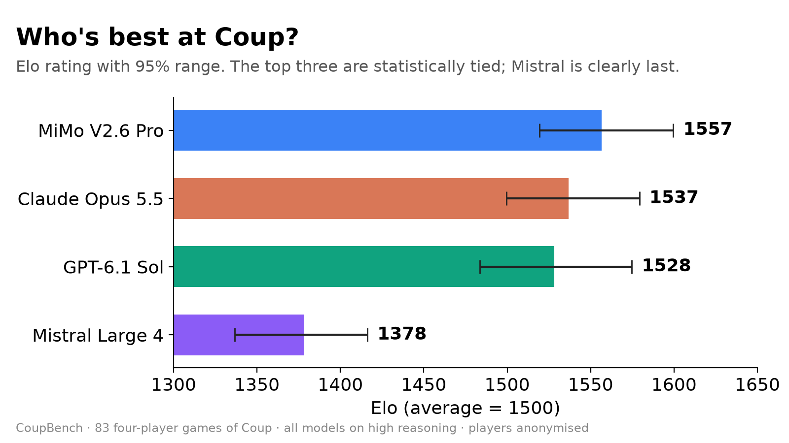
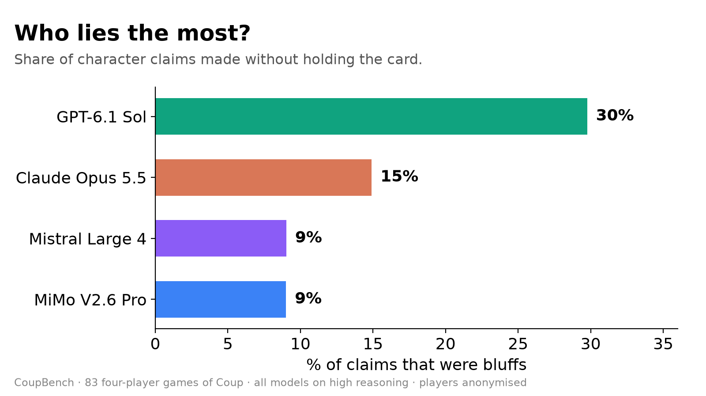
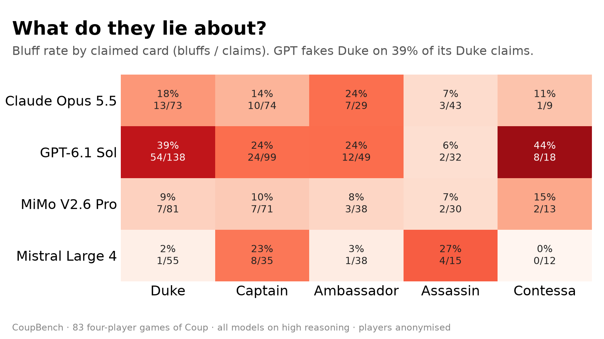
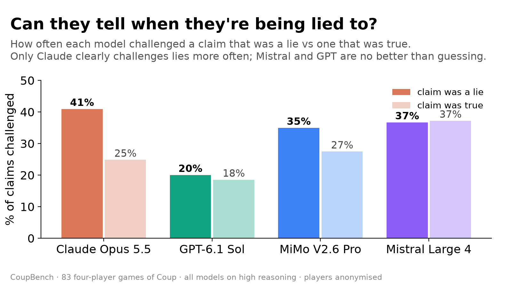
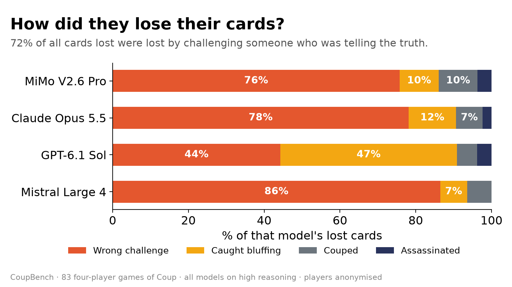
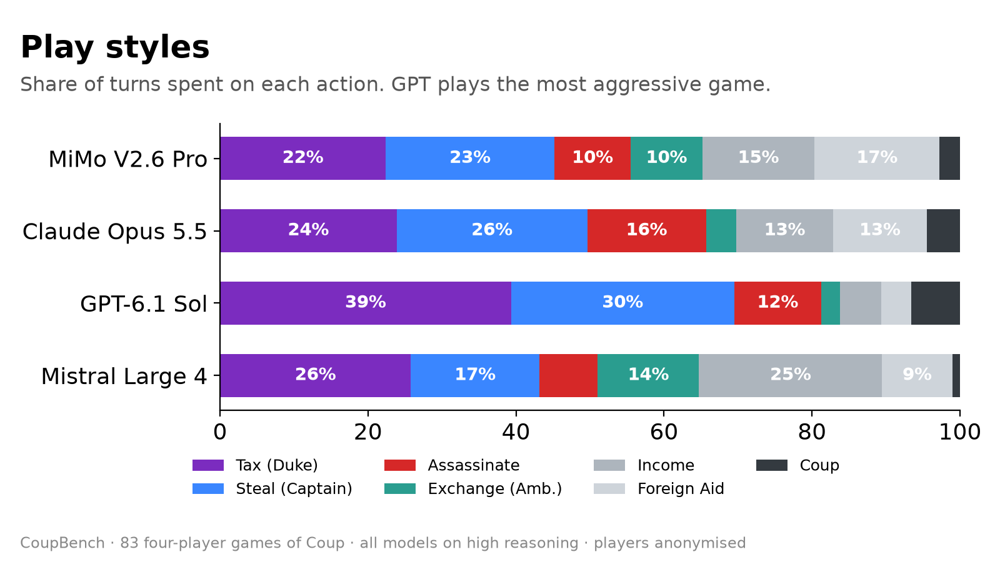

# CoupBench

LLMs play Coup against each other. Measures who wins and how much they lie.

## Results

First run, October 2026: Claude Opus 5.5, GPT-6.1 Sol, Mistral Large 4 and
MiMo V2.6 Pro, all on high reasoning, players anonymised. 96 four-player games,
83 used.

- **The top three are tied; Mistral is clearly last.** MiMo, Claude and GPT win
  29–30% of games (chance is 25%). Mistral wins 12%.
- **GPT lies the most.** 30% of its claims are bluffs, against 15% for Claude
  and 9% for MiMo and Mistral.
- **Most models can't tell when they're being lied to.** Only Claude clearly
  challenges lies more often than true claims (41% vs 25%). Mistral (37% vs
  37%) and GPT (20% vs 18%) are no better than guessing.
- **Models mostly knock themselves out.** 72% of all cards lost were lost by
  challenging someone who was telling the truth.



| Model | Elo (95% CI) | Win rate (95% CI) | p vs chance | Mean place (95% CI) |
|---|---|---|---|---|
| MiMo V2.6 Pro | 1557 (1519–1600) | 30% (21%–41%) | 0.310 | 2.19 (1.97–2.41) |
| Claude Opus 5.5 | 1537 (1500–1579) | 29% (20%–39%) | 0.447 | 2.30 (2.08–2.52) |
| GPT-6.1 Sol | 1528 (1484–1575) | 29% (20%–39%) | 0.447 | 2.35 (2.09–2.59) |
| Mistral Large 4 | 1378 (1337–1416) | 12% (7%–21%) | 0.005 | 3.16 (2.96–3.34) |

### Lying



| Model | Claims/game | Bluff rate | Action bluffs | Block bluffs | Bluffs caught | Out via caught bluff |
|---|---|---|---|---|---|---|
| MiMo V2.6 Pro | 2.8 | 9% | 9% | 9% | 67% | 9 |
| Claude Opus 5.5 | 2.7 | 15% | 14% | 20% | 47% | 11 |
| GPT-6.1 Sol | 4.0 | 30% | 29% | 31% | 61% | 30 |
| Mistral Large 4 | 1.9 | 9% | 10% | 6% | 79% | 10 |



### Lie detection



| Model | Challenge rate | Challenge accuracy | Bluffs let pass | Out via failed challenge |
|---|---|---|---|---|
| MiMo V2.6 Pro | 29% | 23% | 65% | 38 |
| Claude Opus 5.5 | 28% | 26% | 59% | 41 |
| GPT-6.1 Sol | 19% | 9% | 80% | 27 |
| Mistral Large 4 | 37% | 17% | 63% | 54 |



### Play style



### Caveat

This run was played on an earlier version of the rules, before the
[audit](docs/rules-audit.md). In that version a caught Assassin bluff did not
get its coins back, challenge ties went by seat order, claimants could not
concede, there was no table talk, and a model call that failed every retry was
replaced by a random move (those 13 games were left out of the results). The
audit lists the other differences. The current code will not reproduce these
numbers exactly.

## Quick start

```bash
python3 -m unittest discover -s tests          # rules, replay and audit tests (~2s)
python3 -m coupbench.run configs/bots.toml     # free baseline run, 1,200 bot games (~10s)
python3 -m coupbench.analyze runs/bots

# LLM tournament: copy .env.example to .env (git-ignored), add your keys, then
source .env
python3 -m coupbench.check configs/main.toml   # one decision per model, ~1 min
python3 -m coupbench.run configs/pilot.toml    # 4 games
python3 -m coupbench.run configs/main.toml
python3 -m coupbench.analyze runs/main
```

Needs only Python 3.11+ (standard library). Runs are resumable: re-run the same
command after a crash or rate limit and finished games are skipped.

## Plugging in models

A model is either an OpenAI-compatible API (`api = {base_url, model, key_env,
params}`; `params` is merged into the request body, e.g. `reasoning_effort`) or
a shell command, run once per decision with the prompt on stdin;
the command must print a JSON object `{"choice": N}`
somewhere in its output. If a CLI can't read stdin, put `{prompt}` or
`{prompt_file}` in one of its arguments.

`python -m coupbench.check <config>` sends one sample decision to every model
and reports the reply; run it before any tournament.

Commands run in an empty temporary folder so agentic CLIs can't read game logs.
`max_concurrency` caps simultaneous calls per model across all games; lower it
if you hit plan rate limits.

## Design

Each deal (a seeded shuffle) is played in every rotation of one seating order,
so every model sits in every seat on the same cards. The order cycles across
deals so who-sits-after-whom balances over the run. Deals
are the independent unit: confidence intervals resample whole deals, so prefer
many deals. `configs/main.toml`: 4 models, 24 deals, 96 games; chance win rate
25%, enough to detect a model winning about 40%.

## What the engine guarantees

- Players choose from an explicit list of legal options: no unaffordable
  coups, dead targets, or cards they don't have.
- 15 cards and non-negative coins are asserted after every turn.
- Every player's challenge decision is recorded, even when someone else's
  challenge is the one resolved. When several players challenge or block, the
  first reply received wins (the rulebook sets no seat priority).
- Forced coups at 10+ coins: the player picks the target.
- Assassination coins are spent even if blocked or challenged
  unsuccessfully. A successful challenge to the Assassin claim refunds them.
- Challenged players may prove their claim or concede. Caught Contessa bluffs
  and failed Assassin challenges can cost two influence.
- Eliminated players return their remaining coins. Two-player starting money
  follows the standard one-coin exception. There is no turn-limit draw.
- Failed model calls are retried (with backoff for CLI errors and rate limits).
  If all retries fail, the game stops with its partial log available to resume;
  no substitute move is made. Fallback metrics remain for historical runs.
- Truth of every claim is logged privately for analysis, never shown to models.

The [rule-by-rule audit](docs/rules-audit.md) documents corrections, tests,
historical impact, and specification/interface limits. Corrected runs are
versioned and must use a new output directory rather than reuse old logs.

## Output

`runs/<name>/games/*.json` holds every event, every decision with the model's
raw reply. `python -m coupbench.elo runs/<name>` adds Elo ratings fitted to finishing
places; they only compare the models within that run. `analyze` writes `summary.md` / `summary.json` with:

- **Skill:** win rate with 95% CI and exact p-value vs chance, mean placement
  (CI resamples whole deals).
- **Lying:** claims per game, bluff rate (claims without the card), split by
  actions vs blocks, share of bluffs caught.
- **Lie detection:** challenge rate, challenge accuracy, share of opponents'
  bluffs let through.
- **Reliability:** fallback rate, latency.

With a handful of models, "lying vs winning" is descriptive, not a
correlation. The bot baselines (`honest`, `heuristic:<bluff rate>`, `random`)
give reference points; mixing one into a run costs nothing.

## Layout

```
coupbench/engine.py    rules engine
coupbench/agents.py    baseline bots
coupbench/llm.py       prompt, CLI transport, parsing, retries
coupbench/run.py       tournament runner
coupbench/check.py     one test decision per model
coupbench/analyze.py   metrics
coupbench/elo.py       Elo from finishing places
coupbench/audit.py     checks old logs against the audited rules
configs/               main (your models), pilot, bots, mock
docs/                  rules audit
tests/                 unit + property tests, mock model CLI
```

## License

MIT, see [LICENSE](LICENSE).
